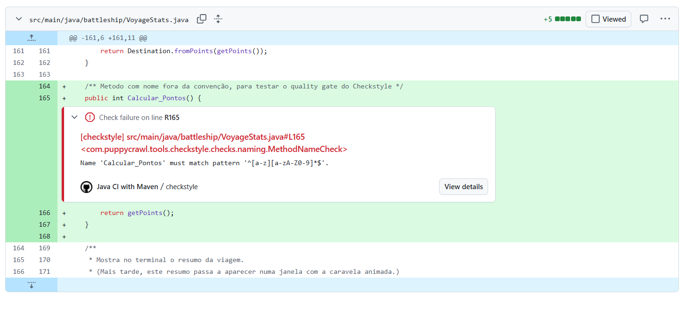

<!-- 122668 - Beatriz Afonso -->
# Quality gate Checkstyle — nomes de métodos (122668)

**Identificador escolhido:** métodos, com a regra `MethodName` e o padrão `^[a-z][a-zA-Z0-9]*$`
(camelCase a começar por minúscula, segundo as Oracle Java Naming Conventions).

**Ficheiros:**
- Configuração: `checkstyle-122668.xml`
- Workflow: `.github/workflows/checkstyle-122668.yaml`

## Execuções do quality gate (pull request #16)

| Execução | Resultado | Ligação |
|---|---|---|
| Método `Calcular_Pontos()` em `VoyageStats.java` |  Falha — linha 165 | https://github.com/LEI-131590/Battleship2/actions/runs/42505352254 |
| Método renomeado para `calcularPontos()` |  Passa | https://github.com/LEI-131590/Battleship2/actions/runs/42506660646 |

## O que o Checkstyle não consegue verificar

O Checkstyle só verifica se o nome segue o formato da expressão regular, não se o nome é significativo: um método chamado `x()` ou `fazerCoisas()` passaria sem problemas. Também não deteta nomes enganadores, como um método `getPoints()` que na verdade altera o estado do objeto, nem nomes em línguas misturadas (português e inglês no mesmo projeto). Essas questões continuam a depender da revisão de código feita por pessoas.