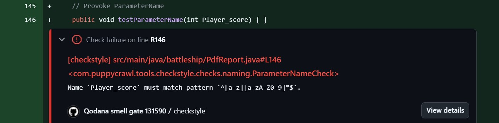

# Quality gate Checkstyle — ParameterName (129885)
### 129885 - Jessica Chen

**Identificador escolhido:** parâmetros, com a regra `ParameterName` e o padrão `^[a-z][a-zA-Z0-9]*$` 

**Ficheiros:**
- Workflow: `.github/workflows/checkstyle-129885.yaml`
- Configuração: `checkstyle-129885.xml`

## Execuções do quality gate (pull request #26)

| Execução | Resultado | Link |
|---|---|---|
| Método `testParameterName(int Player_score)` em `PdfReport.java` | Falha — Name `Player_score` must match pattern `^[a-z][a-zA-Z0-9]*$`, linha 146 | https://github.com/LEI-131590/Battleship2/actions/runs/42523178604 |
| Parâmetro renomeado para `testParameterName(int playerScore)` |  Passa — sem problemas novos | https://github.com/LEI-131590/Battleship2/actions/runs/42524215488 |

## Limitações do Checkstyle
O Checkstyle consegue verificar se os nomes dos parâmetros respeitam o padrão definido, mas não consegue avaliar se esses nomes são semanticamente significativos ou suficientemente descritivos. Por exemplo, um parâmetro chamado x respeita a expressão regular, apesar de poder não explicar claramente a sua finalidade. Assim, a ferramenta verifica a convenção de nomenclatura, mas não garante a qualidade ou legibilidade dos nomes.